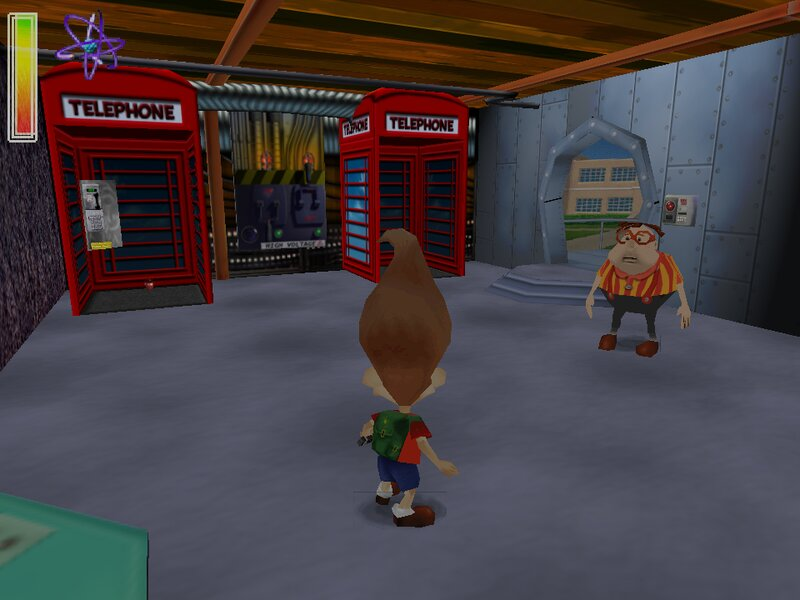
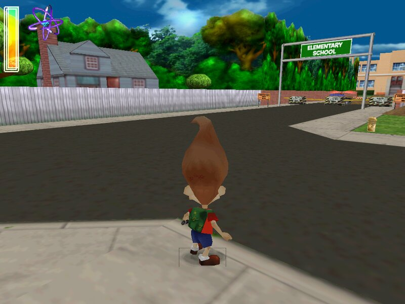
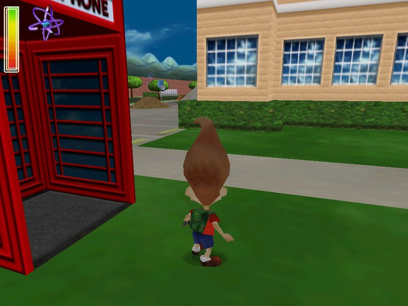
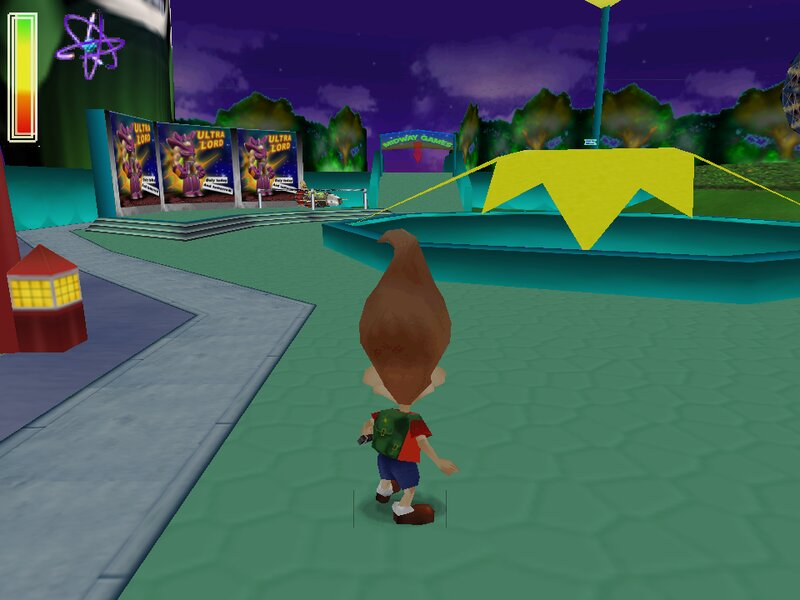
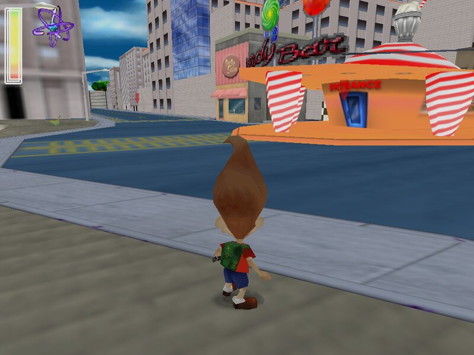
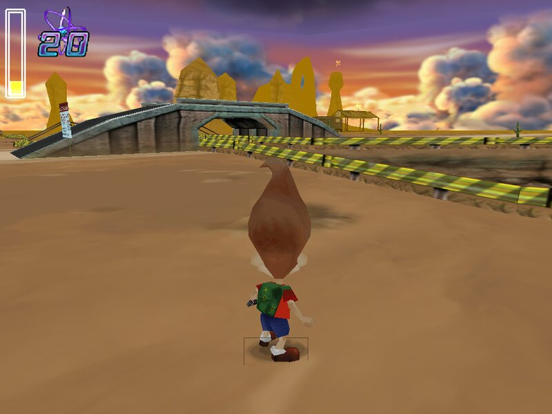

# Jimmy Neutron: Boy Genius Recomp

**Jimmy Neutron: Boy Genius** for Android: the 2001 PC game *Jimmy Neutron: Boy Genius* (THQ),
being rebuilt as a faithful C++ reconstruction of its original code (`Neutron.exe`) to run natively
on Android. Made for the **AYN Thor** (both screens, its gamepad, its lid); it runs on other arm64
Android devices with a gamepad or touch screen.

## Status

**Status: release candidate, about 95%.**
- All 35 levels load and play.
- Logic reconstructed; verified against Neutron.exe.
- 60 fps pacing, music, and widescreen support added.
- Bottom-screen panel is display-only for now.
- Next: Thor test of rc4, then v1.0.

It is built on the engine, launcher and tools of its sequel's port,
[Neutron vs Negatron](https://github.com/sirbilliams/neutron2-android) (*Jimmy Neutron vs. Jimmy
Negatron*, 2002, which was made from Boy Genius's code). The two apps install side by side.

| | |
|---|---|
|  |  |
|  |  |
|  |  |

*Screenshots of this reconstruction running (desktop build, from the author's own copy of the game).*

**You need your own copy of the game.** Nothing of the game is included in this app or this
repository: you install it from the game's CD (an `.iso` image of the disc). The reconstructed code
reads what it needs from your copy when it runs.

## Installing on the AYN Thor

1. On the Thor, download the development build (rebuilt on every change):
   https://github.com/sirbilliams/neutron1-android/releases/download/latest/Jimmy-Neutron-Boy-Genius.apk
   Open it and allow installing from your browser / file manager when Android asks.
2. Copy an image of the *Jimmy Neutron: Boy Genius* PC CD onto the Thor (e.g. into Downloads).
3. Open **Boy Genius** and tap **Choose the game's .iso…**, then pick that file. The app installs the
   game from it the way the CD's setup program does (about 220 MB). The `.iso` isn't needed afterwards.

   Also accepted: a zip of an installed PC copy's game folder (the one with `Neutron.exe`), or that
   folder's contents copied over USB into `Android/data/com.sirbilliams.neutron1/files/game/`.

The launcher (Continue / New Game / Load Game / Saves / Settings / Asset Viewer), the settings
(widescreen, dual screen, Bill's UI), the controls and the bottom-screen companion panel work as in
the Negatron app: [docs/controls.md](docs/controls.md).

The log is at `Android/data/com.sirbilliams.neutron1/files/omt-log.txt` (also Test → Share log).

## Credits and legal

**Jimmy Neutron: Boy Genius Recomp** by **sirbilliams**.

This is a fan project. It is not affiliated with or endorsed by Nickelodeon, Viacom or THQ.
*Jimmy Neutron* and all of the game's content (art, sound, music, text, levels) belong
to their owners; none of it is included here, and you need your own copy of the game.

The engine is our port of the Open Media Toolkit 2.5 by Yves Schmid (LGPL 2.1; its full source is in
`engine/`), with SDL2, gl4es and unshield: see [THIRD_PARTY.md](THIRD_PARTY.md) for their licences.
Release notes: [CHANGELOG.md](CHANGELOG.md).

## For developers

- [docs/HANDOFF.md](docs/HANDOFF.md): where the project stands, the rules, how to set up and continue.
- [docs/decomp-guide.md](docs/decomp-guide.md): how the game's code is reconstructed, conventions.
- [docs/controls.md](docs/controls.md): input, the launcher's interface (`NEG_START`), test hooks.
- `engine/README.md`: every change made to OMT.

**Building.** Every push builds the APK on GitHub Actions (Actions → the run →
*Jimmy-Neutron-Boy-Genius-apk*); pushes to `main` update the `latest` development release, and a
pushed `v*` tag makes a permanent release with its [CHANGELOG](CHANGELOG.md) section as notes. Locally:

```bash
bash build-android.sh          # podman; -> ~/BoyGenius-Android/Jimmy-Neutron-Boy-Genius.apk

# desktop Linux (engine + game, for development)
sudo apt install build-essential cmake libsdl2-dev libgl-dev zlib1g-dev
cmake -S engine -B build && cmake --build build -j
cd /path/to/game-folder && /path/to/build/negatron
```

On a PC, `build/neg_import bg.iso folder/` installs the game from the `.iso` the same way.

**Signing.** CI signs with the key in the `NEG_KEYSTORE_B64` / `NEG_KEYSTORE_PASSWORD` repository
secrets (base64 of a keystore whose key alias is `negatron`), so each APK installs over the last;
without them it falls back to a one-off debug key.
